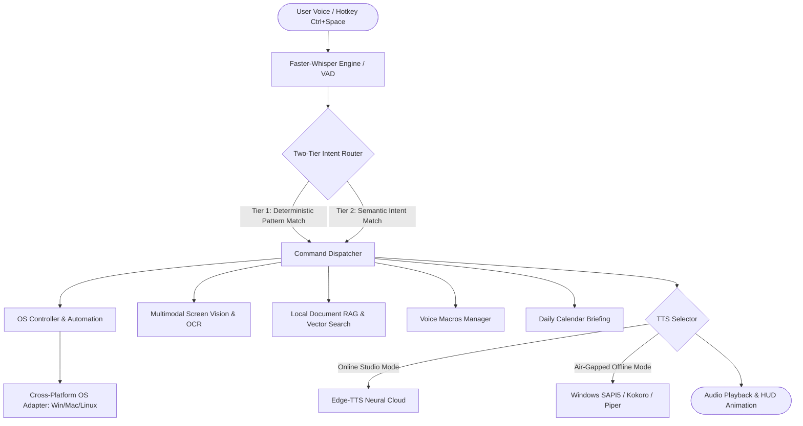

# ⚡ J.A.R.V.I.S. v5.0: Offline, Air-Gapped, Cross-Platform Desktop AI Voice Assistant

[](LICENSE)
[](https://www.python.org/)
[](#-supported-platforms)
[](#-privacy-architecture)
[](#-automated-tests--verification)

A modular, extensible desktop AI voice assistant engineered for **Windows**, **macOS**, and **Linux**. Operates **100% offline and air-gapped** with **zero mandatory external cloud dependencies**, featuring **Faster-Whisper on-device speech recognition**, **multi-engine neural TTS**, **two-tier semantic intent routing**, **multimodal screen vision & error debugging**, **local document RAG**, **voice routine macros**, **offline daily calendar briefings**, an interactive **Arc Reactor holographic HUD**, and an **OS-level network kill-switch**.

---

## 📋 Table of Contents
1. [Architecture Overview](#-architecture-overview)
2. [Supported Platforms & Prerequisites](#-supported-platforms--prerequisites)
3. [Developer Quick Start: From Clone to Running](#-developer-quick-start-from-clone-to-running)
   - [Step 1: Fork & Clone](#step-1-fork--clone)
   - [Step 2: Create Virtual Environment](#step-2-create-virtual-environment)
   - [Step 3: Install Dependencies](#step-3-install-dependencies)
   - [Step 4: Run Pre-Flight Doctor](#step-4-run-pre-flight-doctor)
   - [Step 5: Run the Assistant](#step-5-run-the-assistant)
4. [One-Click Launchers](#-one-click-launchers)
5. [Codebase & Architecture Tour](#-codebase--architecture-tour)
6. [Core Configurations & Options](#-core-configurations--options)
7. [Voice Commands & Controls](#-voice-commands--controls)
8. [Automated Tests & Verification](#-automated-tests--verification)
9. [Standalone Executable Packaging](#-standalone-executable-packaging)
10. [Contributing Guidelines](#-contributing-guidelines)
11. [License & Privacy](#-license--privacy)

---

## 🧠 Architecture Overview



* **Zero Mandatory Cloud Calls**: Functions entirely offline with local Faster-Whisper (`small.en`/`base.en`) and native speech synthesis.
* **Hybrid Multimodal Vision**: When a Gemini API key is provided, enables multimodal screen understanding and error diagnosis; when offline, gracefully falls back to local OCR and window telemetry.
* **Safety Guardrails**: Multi-turn voice confirmation (*"Are you sure you want to..."*) prevents accidental execution of destructive actions (emptying trash, rebooting, shutting down).

---

## 💻 Supported Platforms & Prerequisites

### Minimum Requirements
* **Python**: `3.9`, `3.10`, `3.11`, or `3.12` (Ensure **"Add Python to PATH"** is checked during installation).
* **RAM**: 4 GB minimum (8 GB recommended for Whisper models).
* **Disk Space**: ~1.5 GB for virtual environment and cached local Whisper weights.
* **Microphone & Speakers / Headphones**: Connected and set as default OS devices.

### Platform Matrix
| Operating System | Tested Versions | Architecture | Window Manager / Shell |
| :--- | :--- | :--- | :--- |
| **Windows** | Windows 10, Windows 11 | x86_64, ARM64 | Explorer, PowerShell, CMD |
| **macOS** | Monterey (12) through Sequoia (15) | Apple Silicon (M1–M4), Intel | Aqua, Terminal, zsh |
| **Linux** | Ubuntu 20.04+, Debian 11+, Fedora, Arch | x86_64, aarch64 | X11 / XWayland, bash |

> **Linux System Packages**:
> ```bash
> sudo apt-get update && sudo apt-get install -y portaudio19-dev libasound2-dev espeak-ng ffmpeg
> ```
> **macOS Permissions**:
> On first run, macOS will prompt to grant **Microphone**, **Accessibility**, and **Screen Recording** permissions in *System Settings > Privacy & Security*.

---

## 🚀 Developer Quick Start: From Clone to Running

### Step 1: Fork & Clone

1. Click **Fork** at the top right of the GitHub repository to create your own copy.
2. Clone your fork locally:
```bash
git clone https://github.com/<your-username>/voice_assistant.git
cd voice_assistant
```
3. *(Optional)* Add the upstream remote to sync future updates:
```bash
git remote add upstream https://github.com/original-owner/voice_assistant.git
```

---

### Step 2: Create Virtual Environment

Isolate project dependencies by creating a Python virtual environment:

#### On Windows:
```powershell
python -m venv venv
.\venv\Scripts\activate
```

#### On macOS & Linux:
```bash
python3 -m venv venv
source venv/bin/activate
```

---

### Step 3: Install Dependencies

Upgrade `pip` and install all required libraries:

```bash
pip install --upgrade pip
pip install -r requirements.txt
```

---

### Step 4: Run Pre-Flight Doctor

Run the built-in self-healing diagnostic tool to verify all audio drivers, OS interfaces, and packages:

```bash
python doctor.py
```
`doctor.py` will inspect your environment, verify microphone and speaker availability, check dependencies, and report ready status.

---

### Step 5: Run the Assistant

Start the assistant:

```bash
python main.py
```

The Arc Reactor desktop HUD will initialize on your screen:
* **Say Wake Word**: *"Jarvis"* or *"Buddy"* (a 20-second continuous session window activates).
* **Push-to-Talk**: Press **`Ctrl + Space`** to speak immediately without saying the wake word.
* **Emergency Stop**: Press **`Ctrl + Alt + S`** or click **`🛑 Stop`** on the HUD.

---

## ⚡ One-Click Launchers

For rapid day-to-day execution without opening a terminal:

* **Windows**: Double-click **`run.bat`** (auto-provisions `venv`, verifies dependencies, and boots).
* **macOS / Linux**: Execute **`./run.sh`** (`chmod +x run.sh && ./run.sh`).
* **Silent Background Mode (Windows)**: Double-click **`Start_Buddy.vbs`** (launches without an active console window).

---

## 📂 Codebase & Architecture Tour

```
voice_assistant/
│
├── main.py                  # Application entrypoint & orchestrator lifecycle
├── config.py                # Configuration constants, voices, and user settings loader
├── gui.py                   # CustomTkinter Arc Reactor HUD & Settings Dialog modal
│
├── stt.py                   # Faster-Whisper Speech-to-Text with VAD energy thresholding
├── tts.py                   # Multi-engine TTS (Edge-TTS, SAPI5/OneCore, Kokoro, Piper)
├── intent_router.py         # Two-tier intent classification (Regex + Semantic Similarity)
├── dispatcher.py            # Natural language command routing & multi-turn dialog state
├── actions.py               # Desktop controller (files, windows, power, media, apps)
├── os_adapter.py            # Unified OS abstraction layer (Windows, macOS, Linux)
│
├── vision.py                # Gemini 1.5 Flash Multimodal screen vision & stack trace debugger
├── screen_ocr.py            # Local on-device screen OCR text extractor
├── local_rag.py             # Local SQLite-backed document search (PDF, DOCX, TXT, MD)
├── smart_writer.py          # Extractive text summarization, grammar fix, tone polish
├── clipboard_history.py     # 25-item in-memory clipboard manager with verbal paste
├── macro_manager.py         # Chained multi-step voice macro routines (.buddy_macros.json)
├── calendar_briefing.py     # Local .ics calendar parser for daily morning briefings
│
├── doctor.py                # Self-healing environment doctor & dependency validator
├── run_regression_suite.py  # Master test suite runner executing all 5 phases
│
├── tests/                   # Automated regression test suites
│   ├── __init__.py          # Exposes project root to test runner
│   ├── test_phase1.py       # Core voice, guardrails & intent resolution
│   ├── test_phase2.py       # OS adapters, file sorting & workspace profiles
│   ├── test_phase3.py       # Document RAG, encyclopedia & smart writer
│   ├── test_phase4.py       # Screen OCR & stack trace error diagnostics
│   └── test_phase5.py       # Productivity macros, calendar & network kill-switch
│
├── assets/                  # HUD icon assets and visual themes
├── requirements.txt         # Pinned Python package dependencies
├── .gitignore               # Comprehensive exclusion rules for secrets, caches & models
└── VOICE_COMMANDS.md        # Comprehensive categorized reference of all voice commands
```

---

## ⚙️ Core Configurations & Options

Settings can be changed visually via the **⚙️ Settings** button on the HUD, or programmatically in [config.py](file:///d:/My%20Projects/voice_assistant/config.py):

| Setting | Default | Description |
| :--- | :--- | :--- |
| `strict_offline_mode` | `False` | When `True`, completely blocks cloud calls and uses local Windows SAPI / Kokoro voices. |
| `tts_engine` | `"edge-tts"` | Voice engine: `"edge-tts"`, `"pyttsx3"`, `"kokoro"`, or `"piper"`. |
| `edge_voice` | `"en-GB-RyanNeural"` | Online studio voice (Jarvis UK, Guy US, Christopher Deep US, Sonia UK, etc.). |
| `sapi_voice` | `"TTS_MS_EN-US_DAVID_11.0"` | Offline SAPI voice (*David*, *Mark (Deep)*, *Ravi*, *Zira*, *Heera*). |
| `whisper_model_size` | `"base.en"` | Speech recognition model (`"base.en"` for speed, `"small.en"` for high accuracy). |
| `require_wake_word` | `True` | Requires *"Jarvis"* / *"Buddy"* to activate. When `False`, listens continuously. |
| `gemini_api_key` | `""` | Optional Gemini API key for multimodal screen analysis. |

### Adding Gemini API Key (Optional)
To enable advanced multimodal screen analysis and Q&A:
1. Get a key from [Google AI Studio](https://aistudio.google.com/).
2. Paste it in **HUD Settings > Gemini AI API Key**, or set as an environment variable:
   ```bash
   # Windows (PowerShell)
   $env:GEMINI_API_KEY="your_api_key_here"

   # macOS / Linux
   export GEMINI_API_KEY="your_api_key_here"
   ```
> *Note: If no API key is provided, the assistant automatically uses 100% on-device OCR, window telemetry, and offline encyclopedic Q&A.*

---

## 🗣️ Voice Commands & Controls

The assistant supports over 100+ commands out of the box. See the complete categorized guide in [VOICE_COMMANDS.md](file:///d:/My%20Projects/voice_assistant/VOICE_COMMANDS.md).

### Core Categories Overview:
* **📁 Files & Folders**: *"Open folder camera roll"*, *"How many folders in pictures?"*, *"Organize downloads"*.
* **📬 Google Apps & Web**: *"Open Gmail"*, *"Open Google Docs"*, *"Search YouTube for lo-fi beats"*.
* **👁️ Vision & Debugging**: *"What's on my screen?"*, *"Explain this error on screen"*, *"Copy text from screen"*.
* **⚡ Productivity & Macros**: *"Morning briefing"*, *"Start dictation"*, *"Wrap up for the day"*, *"Set timer for 10 minutes"*.
* **✍️ Smart Writing**: *"Make professional"*, *"Fix grammar"*, *"Summarize this document"*, *"Read clipboard history"*.
* **🔒 System & Security**: *"Lock workstation"*, *"Enable network kill switch"*, *"System diagnostics"*, *"Empty recycle bin"*.

---

## 🧪 Automated Tests & Verification

Developers can run the full 5-phase automated regression suite at any time:

```bash
python run_regression_suite.py
```

Expected output:
```
============================================================
      J.A.R.V.I.S. FULL SYSTEM REGRESSION SUITE
============================================================
>>> [1/5] EXECUTING PHASE 1 TESTS: CORE & INTENT ROUTER          -> PASSED (100%)
>>> [2/5] EXECUTING PHASE 2 TESTS: CROSS-PLATFORM & AUTOMATION   -> PASSED (100%)
>>> [3/5] EXECUTING PHASE 3 TESTS: RAG & OFFLINE INTELLIGENCE    -> PASSED (100%)
>>> [4/5] EXECUTING PHASE 4 TESTS: VISION & ERROR DIAGNOSTICS    -> PASSED (100%)
>>> [5/5] EXECUTING PHASE 5 TESTS: PRODUCTIVITY, MACROS & SANDBOX -> PASSED (100%)
============================================================
  🎉 ALL 5 REGRESSION SUITES PASSED (100% SUCCESS RATE)!
============================================================
```

Individual test phases can also be executed:
```bash
python -m unittest tests/test_phase5.py
```

---

## 📦 Standalone Executable Packaging

To build a standalone executable distribution that runs without Python pre-installed:

```powershell
python build_exe.py
```
Or via PyInstaller directly:
```powershell
pyinstaller --noconfirm --onedir --windowed --name "JARVIS" `
    --add-data "assets;assets" `
    --add-data "config.py;." `
    main.py
```
Output executable is generated in `dist/JARVIS/`.

---

## 🤝 Contributing Guidelines

Contributions are welcome from all developers!

1. **Fork the Repository** on GitHub.
2. **Create a Feature Branch**:
   ```bash
   git checkout -b feature/your-feature-name
   ```
3. **Write Clean Code**: Follow PEP 8 guidelines and add docstrings.
4. **Run the Regression Suite**:
   ```bash
   python run_regression_suite.py
   ```
   Ensure all 5 suites pass with 100% success.
5. **Commit Your Changes**:
   ```bash
   git commit -m "feat: add support for [your feature]"
   ```
6. **Push to Your Fork & Open a Pull Request**:
   ```bash
   git push origin feature/your-feature-name
   ```

---

## 📄 License & Privacy

* **License**: Distributed under the [MIT License](LICENSE).
* **Privacy Guarantee**: All user preferences, notes, clipboard data, and local documents remain strictly on your local machine. No telemetry or audio recordings are sent to third parties.
